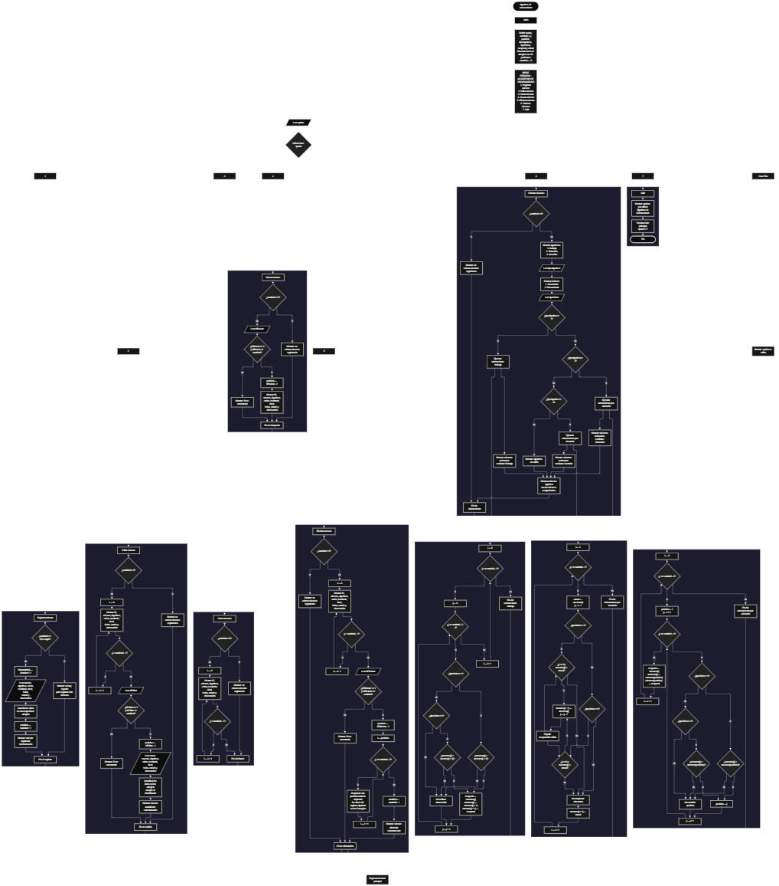

Este proyecto, llamado <b>algoritmo de ordenamiento</b>, fue desarrollado en <b>visual basic .net</b> como un ejercicio práctico para fortalecer la lógica de programación mediante la creación de un sistema de gestión y ordenamiento de números desde la consola. El programa cuenta con un menú principal de siete opciones que permite <b>registrar, editar, eliminar, buscar, listar y ordenar números</b> utilizando diferentes algoritmos de ordenamiento. Cada registro almacena información como el número, el algoritmo, el tipo de orden, el resultado, el nivel, la fecha, el estado y las observaciones, utilizando arreglos con una capacidad máxima de <b>10 registros durante la ejecución</b>. Además, incorpora tres métodos de ordenamiento: <b>burbuja, selección e inserción</b>, que permiten organizar los números de forma ascendente o descendente. Durante su desarrollo se aplicaron conceptos fundamentales de programación, como variables, arreglos, estructuras condicionales, ciclos repetitivos, estructuras de selección, intercambio de valores y reorganización de datos. Este proyecto permite poner en práctica los conocimientos adquiridos en Visual Basic .NET y comprender el funcionamiento de diferentes algoritmos de ordenamiento.

<h2 align="center">⚙️ Funcionamiento del menú principal</h2>

### ➕ Registrar número

La opción <b>1) registrar número</b> permite almacenar un nuevo número junto con su información complementaria. Antes de realizar el registro, el programa comprueba que la cantidad de registros sea menor a la capacidad máxima de los arreglos, utilizando la condición <b>cantidad &lt; ids.Length</b>. Si existe espacio disponible, asigna un identificador mediante <b>ids(cantidad) = cantidad + 1</b> y solicita el <b>número, algoritmo, orden, resultado, nivel, fecha, estado y observación</b>. El número se convierte a tipo <b>Double</b> mediante <b>Convert.ToDouble</b>, mientras que los demás datos se almacenan como cadenas de texto en sus respectivos arreglos. Finalmente, aumenta la variable <b>cantidad</b> en uno y muestra el mensaje <b>"número registrado correctamente."</b>. Si se alcanza la capacidad máxima, presenta el mensaje <b>"no hay espacio para registrar más números."</b>, impidiendo agregar nuevos registros.

### ✏️ Editar número

La opción <b>2) editar número</b> permite modificar la información de un número registrado. Primero, el programa comprueba si existen registros mediante la variable <b>cantidad</b>. Si no hay números almacenados, muestra el mensaje <b>"no existen números registrados."</b>. En caso contrario, utiliza un ciclo <b>For...Next</b> para mostrar los identificadores y toda la información de los registros disponibles. Después, solicita el ID del número que se desea editar y comprueba que se encuentre dentro del rango permitido mediante la condición <b>idEditar &gt;= 1 And idEditar &lt;= cantidad</b>. Si la selección es válida, calcula la posición mediante <b>posicion = idEditar - 1</b> y solicita los nuevos valores del número, algoritmo, orden, resultado, nivel, fecha, estado y observación, actualizando directamente los arreglos correspondientes. El identificador se conserva sin modificaciones. Finalmente, presenta el mensaje <b>"número actualizado correctamente."</b>. Si el ID introducido no corresponde a una posición válida, muestra el mensaje <b>"ID no encontrada."</b>.

### 📋 Listar números

La opción <b>3) listar números</b> permite visualizar todos los números registrados actualmente en el programa. Antes de mostrar la información, comprueba si la variable <b>cantidad</b> es igual a cero. Si no existen registros, presenta el mensaje <b>"no existen números registrados."</b>. Si hay números disponibles, utiliza un ciclo <b>For...Next</b> para recorrer los arreglos desde la posición inicial hasta <b>cantidad - 1</b>. Durante el recorrido, muestra el ID, el número, el algoritmo, el orden, el resultado, el nivel, la fecha, el estado y las observaciones de cada registro. Esta función facilita consultar la información almacenada sin necesidad de buscar cada número individualmente.

### 🔎 Buscar número

La opción <b>4) buscar número</b> permite localizar un registro mediante su identificador. Primero, el programa comprueba si existen números registrados. Si no hay información almacenada, muestra el mensaje <b>"no existen números registrados."</b>. En caso contrario, solicita el ID del número que se desea buscar y verifica que se encuentre dentro del rango permitido mediante la condición <b>idBuscar &gt;= 1 And idBuscar &lt;= cantidad</b>. Si el identificador es válido, calcula la posición utilizando <b>posicion = idBuscar - 1</b> y muestra la información completa del registro: número, algoritmo, orden, resultado, nivel, fecha, estado y observación. Si el ID introducido no corresponde a una posición válida, presenta el mensaje <b>"ID no encontrada."</b>. Esta búsqueda utiliza el identificador para acceder directamente a la posición correspondiente del arreglo.

### 🗑️ Eliminar número

La opción <b>5) eliminar número</b> permite eliminar un registro mediante su identificador. Primero, el programa comprueba si existen números almacenados. Si no hay registros, muestra el mensaje <b>"no existen números registrados."</b>. En caso contrario, utiliza un ciclo <b>For...Next</b> para presentar todos los números con sus respectivos datos. Después, solicita el ID del número que se desea eliminar y verifica que esté dentro del rango permitido. Si la selección es válida, calcula la posición mediante <b>posicion = idEliminar - 1</b> y comienza el proceso de reorganización. Para mantener los registros consecutivos, utiliza un ciclo <b>For...Next</b> que desplaza una posición hacia la izquierda los datos posteriores en los nueve arreglos: <b>ids, numeros, algoritmos, ordenes, resultados, niveles, fechas, estados y observaciones</b>. Posteriormente, disminuye la variable <b>cantidad</b> en uno y muestra el mensaje <b>"número eliminado correctamente."</b>. Si el ID seleccionado no se encuentra dentro del rango permitido, presenta el mensaje <b>"ID no encontrada."</b>.

### 🔃 Ordenar números

La opción <b>6) ordenar números</b> permite organizar los números registrados utilizando tres algoritmos diferentes: <b>ordenamiento burbuja, ordenamiento por selección y ordenamiento por inserción</b>. Primero, el programa comprueba que existan números almacenados. Si no hay registros, muestra el mensaje <b>"no existen números registrados."</b>. En caso contrario, presenta un menú para seleccionar el algoritmo y otro para elegir el tipo de ordenamiento: <b>ascendente o descendente</b>. La selección del algoritmo se almacena en la variable <b>tipoAlgoritmo</b>, mientras que la dirección del ordenamiento se guarda en <b>tipoOrden</b>. Según la selección realizada, ejecuta el método correspondiente mediante estructuras condicionales y ciclos repetitivos.

#### 🫧 Ordenamiento burbuja

Cuando se selecciona la opción <b>1) ordenamiento burbuja</b>, el programa utiliza dos ciclos <b>For...Next</b> para comparar los números consecutivos del arreglo <b>numeros</b>. Si el orden seleccionado es ascendente, comprueba si el número actual es mayor que el siguiente mediante la condición <b>numeros(j) &gt; numeros(j + 1)</b>. Si se cumple, intercambia sus posiciones utilizando la variable temporal <b>temporal</b>. Si el orden es descendente, realiza la comparación contraria mediante <b>numeros(j) &lt; numeros(j + 1)</b>. Este procedimiento se repite hasta organizar todos los números. Finalmente, muestra el mensaje <b>"números ordenados mediante Burbuja."</b>.

#### 🔍 Ordenamiento por selección

Cuando se selecciona la opción <b>2) ordenamiento selección</b>, el programa utiliza dos ciclos <b>For...Next</b> para localizar el número menor o mayor dentro de la parte del arreglo que todavía necesita organizarse. Primero, almacena la posición actual en la variable <b>posicion</b>. Después, recorre los elementos siguientes y compara sus valores con el número ubicado en la posición seleccionada. Para el orden ascendente, busca el número menor mediante la condición <b>numeros(j) &lt; numeros(posicion)</b>. Para el orden descendente, busca el número mayor mediante <b>numeros(j) &gt; numeros(posicion)</b>. Una vez encontrada la posición correspondiente, intercambia los valores utilizando la variable temporal <b>temporal</b>. El procedimiento continúa hasta completar el ordenamiento. Finalmente, muestra el mensaje <b>"números ordenados mediante Selección."</b>.

#### 📥 Ordenamiento por inserción

Cuando se selecciona la opción <b>3) ordenamiento inserción</b>, el programa utiliza un ciclo <b>For...Next</b> para recorrer los números a partir de la segunda posición. En cada repetición, almacena el número que se desea insertar en la variable <b>actual</b> y utiliza la variable <b>j</b> para recorrer los elementos anteriores. Si el orden es ascendente, utiliza un ciclo <b>While</b> para desplazar hacia la derecha los números mayores que el valor almacenado en <b>actual</b>. Si el orden es descendente, desplaza los números menores. Durante este proceso, la variable <b>j</b> disminuye para continuar comparando los elementos anteriores. Cuando encuentra la posición adecuada, coloca el número almacenado en <b>actual</b> mediante la instrucción <b>numeros(j + 1) = actual</b>. Finalmente, muestra el mensaje <b>"números ordenados mediante Inserción."</b>.

Después de ejecutar cualquiera de los tres algoritmos, el programa utiliza un ciclo <b>For...Next</b> para mostrar nuevamente todos los registros. Es importante señalar que el ordenamiento modifica únicamente los valores del arreglo <b>numeros</b>; los demás arreglos conservan sus posiciones originales.

### 🚪 Salir del menú principal

La opción <b>7) salir</b> permite finalizar la ejecución del programa y muestra el mensaje <b>"gracias por utilizar Algoritmo de Ordenamiento."</b>. El menú principal se encuentra dentro de una estructura repetitiva <b>Do...Loop While</b>, que mantiene el programa en funcionamiento mientras la opción seleccionada sea diferente de <b>7</b>. Cuando el usuario selecciona esta opción, se ejecuta el mensaje de despedida y la condición <b>opcion &lt;&gt; 7</b> permite finalizar el ciclo y terminar el programa.

<h2 align="center">🧠 Temas aplicados en el proyecto</h2>

### 📦 Variables

En este proyecto se utilizan variables para controlar la cantidad de números registrados, almacenar la opción seleccionada en el menú, identificar los registros que se desean editar, buscar o eliminar y controlar los procesos de ordenamiento. También se utilizan variables temporales para intercambiar números y conservar los valores que se desplazan durante los diferentes algoritmos.

🔢 **Opcion:** Almacena la opción seleccionada por el usuario en el menú principal.

📊 **Cantidad:** Controla la cantidad actual de números registrados.

🔄 **I:** Funciona como contador en los ciclos utilizados para recorrer los arreglos y ejecutar los algoritmos de ordenamiento.

🔁 **J:** Controla los recorridos internos de los algoritmos de ordenamiento y el desplazamiento de los registros durante la eliminación.

✏️ **IdEditar:** Almacena el identificador del número que se desea modificar.

🔎 **IdBuscar:** Almacena el identificador del número que se desea localizar.

🗑️ **IdEliminar:** Almacena el identificador del número que se desea eliminar.

📍 **Posicion:** Identifica la posición de un número dentro del arreglo y también permite localizar el elemento que se desea seleccionar o intercambiar.

🔃 **TipoAlgoritmo:** Almacena la selección del algoritmo de ordenamiento: burbuja, selección o inserción.

↕️ **TipoOrden:** Almacena el tipo de ordenamiento seleccionado: ascendente o descendente.

🔄 **Temporal:** Almacena temporalmente un número durante el intercambio de valores en los algoritmos de burbuja y selección.

📥 **Actual:** Almacena el número que se desea insertar en su posición correcta durante el ordenamiento por inserción.

### 🗃️ Arreglos

En este proyecto se utilizan nueve arreglos relacionados con la información de cada número registrado. Cada arreglo tiene una capacidad de <b>10 posiciones</b> y utiliza el mismo índice para representar los datos correspondientes a un mismo registro. Por ejemplo, la información almacenada en la posición <b>0</b> se encuentra distribuida entre <b>ids(0), numeros(0), algoritmos(0), ordenes(0), resultados(0), niveles(0), fechas(0), estados(0) y observaciones(0)</b>. Esta organización permite recorrer, consultar, modificar, eliminar y mostrar los registros utilizando sus posiciones correspondientes.

🆔 **Ids(10):** Almacena los identificadores de los números registrados.

🔢 **Numeros(10):** Almacena los valores numéricos de tipo Double que se desean ordenar.

⚙️ **Algoritmos(10):** Almacena el nombre del algoritmo asociado a cada registro.

↕️ **Ordenes(10):** Almacena el tipo de ordenamiento asociado al registro.

📋 **Resultados(10):** Almacena los resultados introducidos por el usuario.

📊 **Niveles(10):** Almacena los niveles correspondientes a cada registro.

📅 **Fechas(10):** Almacena las fechas de los registros.

📌 **Estados(10):** Almacena los estados correspondientes a cada número.

📝 **Observaciones(10):** Almacena las observaciones adicionales de los registros.

### 🔀 Estructuras condicionales

En este proyecto se utilizan las estructuras <b>If, ElseIf y Else</b> para comprobar si existe espacio disponible antes de registrar un nuevo número, verificar si hay registros almacenados antes de ejecutar las operaciones, validar los identificadores utilizados durante la edición, búsqueda y eliminación, seleccionar el algoritmo de ordenamiento y determinar si los números deben organizarse de manera ascendente o descendente. Estas condiciones permiten ejecutar diferentes instrucciones según las decisiones del usuario y los valores almacenados en las variables.

### 🔄 Estructuras repetitivas

En este proyecto se utilizan los ciclos <b>Do...Loop While, For...Next y While...End While</b>. El ciclo <b>Do...Loop While</b> mantiene activo el menú principal hasta que se selecciona la opción de salida. Los ciclos <b>For...Next</b> permiten recorrer los arreglos para mostrar los registros, desplazar los datos durante la eliminación y realizar las comparaciones necesarias en los algoritmos de burbuja, selección e inserción. Por otro lado, el ciclo <b>While...End While</b> se utiliza específicamente en el ordenamiento por inserción para desplazar los números que no se encuentran en la posición correcta.

### 🎯 Estructura de selección

El programa utiliza la estructura <b>Select Case</b> para evaluar el valor almacenado en la variable <b>opcion</b> y ejecutar el bloque de instrucciones correspondiente. Cada caso representa una operación específica del sistema: <b>registrar, editar, listar, buscar, eliminar, ordenar o salir</b>. También se utiliza el bloque <b>Case Else</b> para mostrar el mensaje <b>"opción no válida."</b> cuando el usuario introduce un número que no coincide con ninguna de las opciones definidas en el menú principal.

### 🔢 Dimensionamiento de arreglos

El programa utiliza la declaración <b>Dim</b> para establecer la capacidad de los arreglos que almacenan la información de los números. Se definieron <b>10 posiciones</b> para cada uno de los nueve arreglos, utilizando índices desde <b>0 hasta 9</b>. La capacidad disponible se consulta mediante la propiedad <b>ids.Length</b>, mientras que la cantidad de posiciones ocupadas se controla mediante la variable <b>cantidad</b>. De esta manera, las operaciones recorren únicamente los registros comprendidos entre la primera posición y el total actual de números almacenados.

### 🔄 Reorganización de registros

En este proyecto se aplican dos procesos de reorganización. El primero se utiliza durante la eliminación de un número, donde un ciclo <b>For...Next</b> desplaza una posición hacia la izquierda los datos posteriores en los nueve arreglos, permitiendo mantener los registros consecutivos. Después, la variable <b>cantidad</b> disminuye en uno. El segundo proceso corresponde a los algoritmos de ordenamiento, que reorganizan los valores almacenados en el arreglo <b>numeros</b> mediante comparaciones, desplazamientos e intercambios. Para estos procedimientos se utilizan las variables <b>temporal</b>, <b>actual</b>, <b>posicion</b> y los contadores <b>i</b> y <b>j</b>.

<h2 align="center">¿Cómo se implementaron las operaciones crud en el proyecto?</h2>

Las operaciones <b>crud</b> se implementaron mediante las opciones del menú principal, permitiendo administrar los números registrados. La operación <b>crear</b> corresponde a <b>registrar número</b>, donde se almacenan los datos de un nuevo registro; <b>leer</b> se realiza mediante las opciones <b>buscar número y listar números</b>; <b>actualizar</b> corresponde a <b>editar número</b>, donde se modifican los datos de un registro existente; y <b>eliminar</b> se realiza mediante la opción <b>eliminar número</b>, que desplaza los datos posteriores para reorganizar los arreglos. Además, el proyecto incorpora una operación adicional de <b>ordenamiento</b>, que permite organizar los números mediante los métodos de burbuja, selección e inserción, en orden ascendente o descendente.

<h2 align="center">Diagrama de flujo del proyecto</h2>

<h2 align="center">🛡️ Validaciones del programa</h2>

### 📭 No existen números registrados

Esta validación se utiliza en las opciones de <b>editar, listar, buscar, eliminar y ordenar números</b>. El programa comprueba si la variable <b>cantidad</b> es igual a <b>0</b> y, si no existen registros almacenados, muestra el mensaje <b>"no existen números registrados."</b>. Esta comprobación evita continuar con las operaciones que necesitan información almacenada cuando el arreglo se encuentra vacío.

### ⚠️ Capacidad máxima alcanzada

Esta validación se utiliza durante el registro de nuevos números para controlar la capacidad máxima de los arreglos. El programa comprueba si <b>cantidad &gt;= ids.Length</b> antes de permitir agregar un nuevo registro. Si existe espacio disponible, almacena los datos y aumenta el contador. En caso contrario, muestra el mensaje <b>"no hay espacio para registrar más números."</b>, impidiendo superar la capacidad de 10 registros.

### 🔢 Identificador no encontrado

Esta validación se utiliza durante las operaciones de <b>editar, buscar y eliminar números</b>. El programa comprueba que el identificador introducido se encuentre dentro del rango comprendido entre <b>1 y cantidad</b>. Si el ID está dentro del rango, calcula la posición correspondiente restándole uno. Si el identificador no cumple esta condición, muestra el mensaje <b>"ID no encontrada."</b>, evitando acceder a una posición que se encuentre fuera del rango de registros considerado válido.

### ⚙️ Selección del algoritmo de ordenamiento

Esta validación se utiliza cuando el usuario selecciona el método de ordenamiento. El programa evalúa la variable <b>tipoAlgoritmo</b> mediante las condiciones <b>tipoAlgoritmo = 1</b>, <b>tipoAlgoritmo = 2</b> y <b>tipoAlgoritmo = 3</b>. Cada valor permite ejecutar respectivamente los algoritmos de <b>burbuja, selección e inserción</b>. Si el valor introducido no corresponde a ninguno de estos métodos, muestra el mensaje <b>"algoritmo no válido."</b>. Sin embargo, el programa no realiza una validación equivalente para comprobar que <b>tipoOrden</b> sea 1 o 2, por lo que un valor diferente puede impedir que el algoritmo realice correctamente el ordenamiento.

### ↕️ Orden ascendente y descendente

El programa permite seleccionar dos modalidades de ordenamiento mediante la variable <b>tipoOrden</b>. Cuando su valor es <b>1</b>, los algoritmos organizan los números de menor a mayor; cuando su valor es <b>2</b>, los organizan de mayor a menor. Cada algoritmo utiliza condiciones de comparación diferentes para realizar los intercambios o desplazamientos necesarios. Esta selección permite obtener dos resultados de ordenamiento utilizando los mismos datos registrados.

### ⚠️ Reorganización de los datos relacionados

Durante la ejecución de los algoritmos de ordenamiento, únicamente se modifica el arreglo <b>numeros</b>, mientras que los arreglos <b>ids, algoritmos, ordenes, resultados, niveles, fechas, estados y observaciones</b> conservan sus posiciones originales. Por esta razón, después de ordenar los números, los valores pueden dejar de corresponder a la información complementaria de su registro original. Además, cuando se elimina un registro, los datos se desplazan hacia la izquierda, pero los identificadores no se renumeran. Como las operaciones de edición, búsqueda y eliminación calculan la posición mediante <b>ID - 1</b>, esta situación puede provocar que se acceda a un registro diferente después de eliminar un elemento intermedio.

### ⚠️ Conversión de datos

El programa utiliza <b>Convert.ToInt32</b> para convertir las opciones e identificadores introducidos por el usuario y <b>Convert.ToDouble</b> para convertir los números registrados y editados. Sin embargo, no utiliza mecanismos adicionales como <b>Integer.TryParse</b> o <b>Double.TryParse</b> para comprobar previamente si los datos introducidos son válidos. Por esta razón, ingresar un valor que no pueda convertirse puede provocar un error durante la ejecución.

### ❌ Opción inválida

La estructura <b>Select Case</b> incluye el bloque <b>Case Else</b>, que muestra el mensaje <b>"opción no válida."</b> cuando el usuario introduce un número que no corresponde a ninguna de las siete opciones del menú principal. Esta condición permite informar al usuario cuando selecciona una operación que no se encuentra disponible.

<h2 align="center">🎯 Objetivo del proyecto</h2>

El objetivo principal de este proyecto es fortalecer la <b>lógica de programación</b> mediante el desarrollo de un sistema de gestión y ordenamiento de números en <b>visual basic .net</b>. A través de su construcción se busca aplicar los conocimientos adquiridos sobre variables, arreglos, estructuras condicionales, ciclos repetitivos y estructuras de selección, integrándolos para resolver un problema de manera organizada. Además, permite comprender el funcionamiento de tres algoritmos clásicos de ordenamiento: <b>burbuja, selección e inserción</b>, aplicando comparaciones, intercambios y desplazamientos para organizar valores de manera ascendente y descendente. Este proyecto también permite practicar las operaciones CRUD y comprender cómo administrar información almacenada en arreglos dentro de una aplicación de consola.

